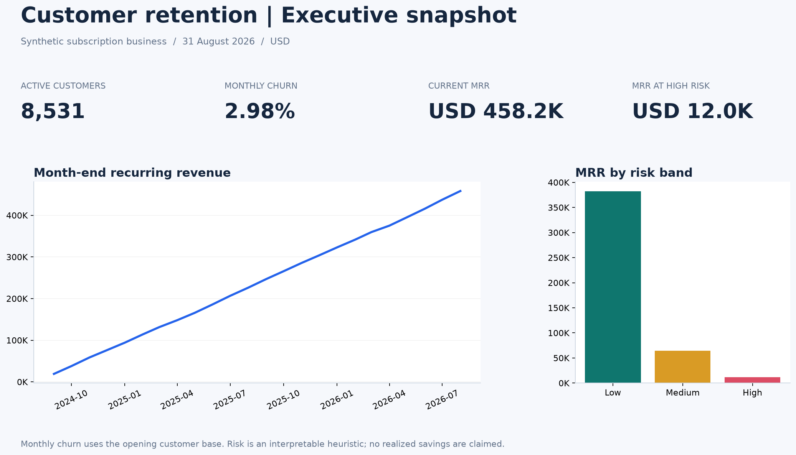

# Customer Churn & Retention Analytics

**Python · Pandas · NumPy · SQL · SQLite · Amazon S3 · Athena · Amazon QuickSight**

An executed subscription analytics portfolio covering churn, cohort retention, recurring revenue, customer segmentation, interpretable risk scoring and a supporting prediction prototype. The dataset is synthetic and the AWS dashboard layer is prepared for deployment.

## Business problem

A subscription team needs to identify retention weaknesses, compare acquisition quality, understand revenue exposure and prioritize customer interventions. This project answers those questions with dated subscription records and clearly defined denominators. Recommendations are proposed tests; no realized business impact is claimed.

## Verified results

Cutoff: **31 August 2026**. Currency: **USD**.

| Metric | Result |
|---|---:|
| Generated customers | 12,000 |
| Valid customers after quarantine | 11,880 |
| Valid customer-month observations | 107,858 |
| Active / churned customers | 8,531 / 3,349 |
| August monthly churn / retention | 2.98% / 97.02% |
| Cumulative churn | 28.19% |
| Current MRR | USD 458,229.60 |
| Active ARPU | USD 53.71 |
| Active high-risk customers | 212 |
| High-risk MRR | USD 11,977.55 |
| High-value + high-risk customers | 46 |
| Observed subscription revenue | USD 5,569,843.56 |
| Average observed CLV | USD 468.84 |
| August net customer growth | 398 |

Machine-readable results: [executive_kpis.json](outputs/executive_kpis.json). These bundled values correspond to the default seed and scenario.

## How to run

Use **Python 3.12** and run commands from this repository's root. No AWS account is required for local analysis.

Windows PowerShell, without requiring virtual-environment activation:

    py -3.12 -m venv .venv
    .\.venv\Scripts\python.exe -m pip install -r requirements.txt
    .\.venv\Scripts\python.exe -m scripts.run_pipeline --test

macOS/Linux:

    python3.12 -m venv .venv
    .venv/bin/python -m pip install -r requirements.txt
    .venv/bin/python -m scripts.run_pipeline --test

The command regenerates deterministic raw inputs, cleans data, builds marts and SQLite, executes all SQL, trains models, produces charts and insights, executes four notebooks, and runs validations and tests. It creates local caches under .cache, excluded from Git.

For analysis without notebook execution or tests:

    python -m scripts.run_pipeline

To reuse raw inputs:

    python -m scripts.run_pipeline --skip-generate --test

To run checks alone after the full build:

    python -m scripts.validation
    python -m pytest -q

Open [outputs/dashboard_preview.html](outputs/dashboard_preview.html) in a browser for a five-tab static preview. Open the executed notebooks in a Jupyter-compatible editor. They contain analysis, assertions, tables and chart outputs. No local web server is required.

## Architecture

    Synthetic customer data + monthly subscription snapshots
        → Python / Pandas cleaning and quarantine
        → Churn, retention, cohort and revenue analytics
        → SQLite and 32 independently executed SQL queries
        → 14 processed analytics marts
        → Amazon S3
        → Athena string staging tables + typed views
        → Amazon QuickSight / SPICE
        → Business insights and retention experiments

The local stages have been executed. AWS stages require your authenticated account, bucket, permissions, imports and dashboard publication.

## Dataset and data cleaning

Seed: 20260913. Window: September 2024–August 2026. Three plans, monthly/annual contracts, five acquisition channels, four regions and 12,000 generated customers. Synthetic engagement, payment friction and contract characteristics influence simulated cancellation likelihood; observed associations therefore reflect the generator's assumptions.

Injected defects include exact duplicates, missing categories, inconsistent plan labels, negative fees, invalid tenure, conflicting cancellation dates, future starts, status mismatches and invalid discounts. The cleaning pipeline removes exact duplicates, applies documented deterministic repairs and quarantines ambiguous records. The 120 quarantined customers and all their monthly records are excluded consistently.

See [data quality report](outputs/data_quality_report.json), [repair log](data/quarantine/repair_log.csv) and [data dictionary](DATA_DICTIONARY.md). Raw inputs are preserved.

## Metric definitions and analytical safeguards

**Churn = effective subscription cancellation or termination.** Inactivity is a risk signal, not another churn definition.

Monthly churn uses cancellations from the opening customer base divided by that opening base. Same-month acquired-and-churned customers are separately counted and included in the customer bridge. Monthly retention is retention of opening customers. Cumulative churn and active customer share are separately labeled.

MRR is a stock; recognized revenue is prorated for active calendar days. Observed CLV is historical earned revenue, not predicted lifetime value. High-risk MRR is a prioritization pool, not expected loss or realized savings.

[METRIC_DEFINITIONS.md](METRIC_DEFINITIONS.md) documents every denominator, period, null policy, risk component, segment rule and assumption.

## SQL, churn drivers and retention

[32 SQL queries](sql/analysis_queries.sql) cover customer counts, monthly rates, plan/contract/channel/geography, payment and support behavior, CLV, cohort survival, renewal opportunities, revenue concentration and revenue bridges. Every query has a saved CSV under outputs/sql_results. The database has primary keys, foreign keys and financial constraints.

Primary driver charts use active month-end telemetry and next-month cancellation outcomes. Latest-observation customer comparisons are marked as descriptive. Retention comparisons by plan, contract, acquisition channel and region use a fixed cohort-age-6 horizon to avoid unequal follow-up.

Cohort retention uses subscription-start month, original cohort size and end-of-target-month survival. Month 0 is actual acquisition-month survival. Future ages are null, and age-specific KPIs weight cohorts by size.

## Segmentation and risk

Eleven mutually exclusive segments cover churned high/low value, high-value at risk, at risk, dormant, new, loyal high value, loyal standard, highly engaged, low engagement and core customers.

The heuristic score assigns auditable points for inactivity, engagement, support, complaints, failed payments, low usage, new tenure, disabled auto-renew and usage decline. Scores are 0–100 and apply to active customers only. High value means monthly revenue ≥USD 80; high risk means score >60.

The score is a transparent prioritization framework, not a production model or calibrated probability.

## Supporting machine learning

Compare logistic regression, a shallow decision tree and a majority-class baseline. Train/validation/test are separated by customer and time. Labels are next-month cancellations; no future churn status, final CLV or cancellation date is a feature.

Logistic regression was selected on validation average precision. Held-out test results:

| Accuracy | Precision | Recall | F1 | ROC-AUC | Average precision |
|---:|---:|---:|---:|---:|---:|
| 87.97% | 7.06% | 29.17% | 0.114 | 0.650 | 0.062 |

The majority baseline has 97.36% accuracy but detects no cancellations; its average precision is 0.026. This demonstrates why majority-class accuracy is insufficient. Model precision and recall remain modest, scores are uncalibrated and repeated customer-months are correlated.

See [model metrics](outputs/model/model_metrics.json), split audit, coefficients, predictions and [model notebook](notebooks/04_churn_model.ipynb).

## Evidence and recommendations

- Low engagement had 6.00% next-month churn versus 1.60% for high engagement.
- At cohort age 6, referral customers retained 83.6% versus 76.8% for social acquisitions.
- Annual contracts retained 86.2% at age 6 versus 77.6% for monthly contracts.
- The current high-value/high-risk pool contains 46 customers and USD 4,796 in MRR.

These are synthetic, unadjusted associations. See [16 computed insights](outputs/business_insights.md) for numerators, denominators and dashboard mapping. Recommended tests include targeted outreach, payment recovery, onboarding, support follow-up and low-usage re-engagement.

The [retention experiment plan](outputs/retention_experiment_plan.md) specifies randomization, evaluation metrics, guardrails and the small-sample limitation. Marketing spend and service costs are unavailable, so CAC, ROI, margins and realized savings are not calculated.

## Amazon S3, Athena and QuickSight

The boto3 uploader validates local files and supports a credential-free dry run:

    python -m scripts.upload_to_s3 --bucket your-actual-bucket --dry-run

For actual deployment, configure your AWS SSO profile/IAM role and environment, regenerate Athena SQL/manifests with your bucket, and follow the [step-by-step build guide](quicksight/quicksight_build_guide.md).

Athena uses separate dataset prefixes and string CSV staging with typed views to handle ISO dates and nullable numeric fields correctly. QuickSight can use Athena with SPICE, or directly ingest small S3 CSV datasets via manifests.

The five designed sheets are Executive Overview, Churn Drivers, Customer Segments & Risk, Retention & Cohorts, and Revenue & Retention Opportunity. Their field wells, formulas, filter scopes, join constraints and interactions are specified in:

- [Dashboard plan](quicksight/dashboard_plan.md)
- [Dataset mapping](quicksight/dataset_mapping.md)
- [Calculated fields](quicksight/calculated_fields.md)
- [S3 setup](quicksight/s3_setup.md)
- [Dashboard QA checklist](quicksight/dashboard_qa_checklist.md)

**No live AWS dashboard has been created by the bundled local run.** AWS authorization, Athena execution, SPICE import, formula compilation and publication remain console validation steps.

## Validation and reproducibility

The pipeline executes 100 reconciliation checks and a broader pytest suite with cleaning edge cases, cohort boundaries, risk thresholds, upload fakes, missing-credential handling, manifest contracts and Athena view syntax checks. See [validation report](outputs/validation_report.json), [test results](outputs/test_results.xml), [notebook execution report](outputs/notebook_execution_report.json) and [run manifest](outputs/run_manifest.json).

The run manifest records package versions, execution stages and SHA-256 hashes for raw/processed data. Dependencies are pinned in requirements.txt. The bundled SQL and marts have also been checked against independent customer-date and billing calculations.

## Repository structure

    data/raw/                      Preserved corrupted synthetic inputs and generation metadata
    data/processed/                14 analytics datasets
    data/quarantine/               Excluded records and field-level repair log
    scripts/                       Generation, cleaning, analytics, SQL, model, reports, AWS export
    sql/                           Constrained SQLite schema and 32 named queries
    notebooks/                     Four executed analytical notebooks
    quicksight/                    Dashboard guides, typed Athena SQL, contracts and S3 manifests
    outputs/charts/                Professional Matplotlib figures
    outputs/sql_results/           One result CSV per query
    outputs/model/                 Metrics, split audit, coefficients and test predictions
    outputs/                       KPI/audit reports, experiment plan and local preview (database is regenerated)
    tests/                         Reconciliation and edge-case regression tests

Large generated files are not committed to keep the repository light: `data/raw/monthly_snapshots.csv`, `data/processed/monthly_snapshots.csv` and `outputs/churn_retention.sqlite`. Run `python -m scripts.run_pipeline` to regenerate them deterministically from the seed.

## Limitations

Synthetic data cannot establish real-world churn drivers. The observation window is finite, churn is absorbing, contracts and prices are static, and revenue follows a simplified proration convention. Risk thresholds and the USD 80 value cutoff are assumptions. There is no intervention history, causal evidence, acquisition cost or production model monitoring.

## Reference documentation

AWS references for CSV parsing, manifests, credentials and QuickSight formulas are linked next to their implementation guidance. They were checked while preparing this project. Live service settings depend on the account and Region.
